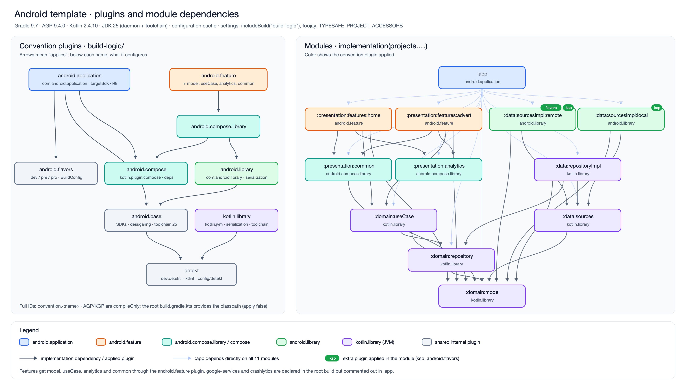

<div align="center">

# 📱 Android Template

**A modular, ready-to-ship starting point for Android apps built with Kotlin and Jetpack Compose.**

[](https://github.com/Samuel-Ambrosio/BaseProject/actions/workflows/ci.yml)
[](LICENSE)


[Features](#-features) •
[Tech stack](#-tech-stack) •
[Getting started](#-creating-a-new-app-from-this-template) •
[Project structure](#-project-structure) •
[Tooling](#-tooling) •
[License](#-license)

</div>

---

## ✨ Features

- 🧱 **Clean, multi-module architecture** — `domain`, `data` and `presentation` layers split into focused Gradle modules.
- 🔌 **Convention plugins** in a `build-logic` included build — no duplicated build scripts.
- 🌍 **Build flavors** `dev` / `pre` / `pro`, each with its own API base path.
- 🎨 **Jetpack Compose + Material 3**, Navigation 3 and a splash screen out of the box.
- 🔥 **Firebase Analytics & Crashlytics** and **AdMob** wired in, ready to switch on.
- 💾 **Room** and **DataStore** prepared for local storage.
- 🔍 **Detekt + ktlint** static analysis and a **GitHub Actions** CI pipeline.

## 🛠 Tech stack

| Area | Libraries |
| --- | --- |
| Language | Kotlin, Coroutines, kotlinx.serialization |
| UI | Jetpack Compose, Material 3, Navigation 3, SplashScreen |
| DI | Koin |
| Networking | Retrofit, OkHttp, Moshi |
| Storage | Room, DataStore |
| Firebase | Analytics, Crashlytics |
| Ads | Google Mobile Ads (AdMob) |
| Logging | Timber |
| Quality | Detekt, ktlint, JUnit, Espresso |

All versions are managed in [`gradle/libs.versions.toml`](gradle/libs.versions.toml).

---

## 🚀 Creating a new app from this template

Work through this list top to bottom. Everything marked *optional* can stay as it is.

### 1️⃣ Identity <sup>`required`</sup>

- [ ] `gradle.properties` → `app.name` (launcher label; the Gradle root project uses it without spaces) and `app.applicationId` (Play Store id).
- [ ] `app/build.gradle.kts` → `versionCode` / `versionName`.
- [ ] *Optional* — package prefix `com.samuelav`: it is the author's namespace, not the app's, so it does not need to change. To change it, rename the source folders of every module, `build-logic/.../Namespaces.kt`, the `com.samuelav.buildlogic` package and the rules in `app/proguard-rules.pro`.

### 2️⃣ Branding <sup>`required`</sup>

- [ ] Launcher icon: `presentation/common/src/main/res/mipmap-*/ic_launcher*` and `drawable(-night)/ic_launcher_{foreground,background}.xml` (Android Studio → *New → Image Asset*). The foreground drawable is also the splash icon (`app/src/main/res/values/themes.xml`).
- [ ] Colors and theme: `presentation/common/src/main/res/values/colors.xml`, `themes.xml` and `ui/theme/*.kt`.
- [ ] Strings in `presentation/common/src/main/res/values/strings.xml`: `app_email_contact` (default recipient of `sendEmail`), `app_share_link` (Play Store link to use with `shareText`), and `developed_by` (also in `values-es/`).

### 3️⃣ Backend <sup>`required`</sup>

- [ ] `API_BASE_PATH` per environment (`dev` / `pre` / `pro`) in `build-logic/src/main/kotlin/convention.android.flavors.gradle.kts`.
- [ ] Replace the sample *Todo* feature (`jsonplaceholder`): `TodoService`, `NetworkTodo`, `TodoRemoteDataSource(Impl)`, `TodoRepository(Impl)`, `GetAllTodosUseCase`, `Todo` and the home screen that uses it.

### 4️⃣ Firebase — Analytics + Crashlytics <sup>`required before release`</sup>

> [!WARNING]
> The Firebase SDKs are already dependencies; until this step is done, Analytics/Crashlytics calls will fail at runtime.

- [ ] Create the Firebase project, register `app.applicationId` and copy `google-services.json` into `app/`.
- [ ] `app/build.gradle.kts` → uncomment `alias(libs.plugins.googleServices)` and `alias(libs.plugins.crashlytics)`.
- [ ] `app/src/main/kotlin/com/samuelav/app/App.kt` → uncomment `FirebaseApp.initializeApp`, the `CrashReportingTree` and `Timber.plant`.

### 5️⃣ Ads — AdMob <sup>`optional`</sup>

- [ ] Create the AdMob app and a banner ad unit.
- [ ] `app/src/main/AndroidManifest.xml` → uncomment the `com.google.android.gms.ads.APPLICATION_ID` meta-data and set the AdMob app id.
- [ ] `strings.xml` → `ad_id_banner` with the banner ad unit id.
- [ ] `app/build.gradle.kts` → uncomment `implementation(libs.google.services.ads)`, and add it to `presentation/features/advert/build.gradle.kts` too.
- [ ] `presentation/features/advert/.../AdvertBanner.kt` → uncomment the `AdView` block (and its imports).

> [!TIP]
> Not using ads? Delete the `:presentation:features:advert` module instead.

### 6️⃣ Local storage <sup>`optional`</sup>

- [ ] Room: uncomment `data/sourcesImpl/local/.../AppRoomDatabase.kt` and the provider in `di/LocalModule.kt`, then add entities and DAOs.
- [ ] DataStore file name: `"data-store"` in `di/LocalModule.kt`.

### 7️⃣ Release <sup>`required before publishing`</sup>

- [ ] Add a `signingConfig` for `release` (keystore kept out of git, e.g. read from `local.properties` or CI secrets).
- [ ] Review `app/proguard-rules.pro` with a minified `assembleProRelease` build.
- [ ] CI runs on `master` (`.github/workflows/ci.yml`); change the branch if yours differs.

---

## 🗂 Project structure

Build configuration lives in the `build-logic` included build as convention plugins (`convention.*`), applied by each module through `plugins { id("convention.…") }`. Modules depend on each other through type-safe project accessors (`implementation(projects.domain.model)`).

```text
.
├── app/                     → Application entry point, DI setup
├── domain/
│   ├── model/               → Business models
│   ├── repository/          → Repository contracts
│   └── useCase/             → Use cases
├── data/
│   ├── repositoryImpl/      → Repository implementations
│   ├── sources/             → Data source contracts
│   └── sourcesImpl/
│       ├── remote/          → Retrofit services
│       └── local/           → Room / DataStore
├── presentation/
│   ├── common/              → Theme, resources, shared UI
│   ├── analytics/           → Analytics abstraction
│   └── features/
│       ├── home/            → Sample feature
│       └── advert/          → AdMob banner
└── build-logic/             → Convention plugins
```

<details>
<summary><b>📊 Convention plugins and module dependency graph</b></summary>
<br>



</details>

---

## 🧰 Tooling

### 🔍 Static analysis (Detekt)

```bash
./gradlew detekt
```

Add `-PdetektAutoCorrect=true` to let the ktlint ruleset fix issues in place. Shared rules live in [`config/detekt/detekt.yml`](config/detekt/detekt.yml).

### 📦 Dependency updates

```bash
./gradlew dependencyUpdates --no-parallel
```

> [!NOTE]
> The versions plugin supports neither parallel execution nor the configuration cache, which the task opts out of.

### ⚙️ Continuous integration

Every push/PR to `master` runs [`.github/workflows/ci.yml`](.github/workflows/ci.yml) on JDK 25: **Detekt**, **unit tests**, and a **`dev` debug assemble**.

To reproduce the same checks locally (Gradle provisions JDK 25 for the daemon and the toolchain if it is not installed, see `gradle/gradle-daemon-jvm.properties`):

```bash
./gradlew detekt testDevDebugUnitTest test assembleDevDebug --continue
```

---

## 📄 License

This project is licensed under the **MIT License** — you are free to use, copy, modify and distribute it, including for commercial purposes, as long as the copyright notice is kept. See [`LICENSE`](LICENSE) for details.

<div align="center">
<sub>Made with ❤️ by <a href="https://github.com/Samuel-Ambrosio">Samuel Ambrosio</a></sub>
</div>
